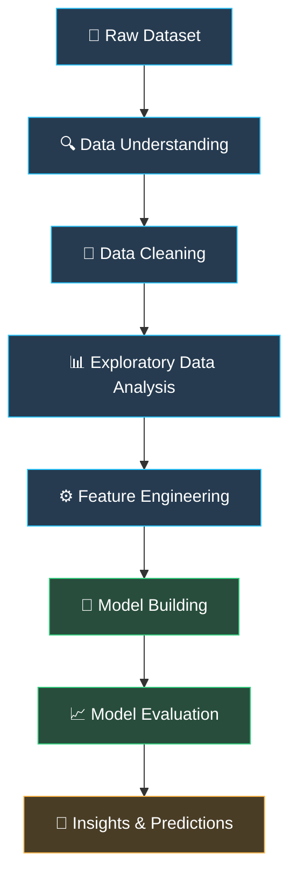

# 📊 Data Science Practice

<div align="center">

### 

<br/>

[](https://github.com/GouravSinghDosad)
[](https://www.python.org/)
[](https://scikit-learn.org/)
[](https://jupyter.org/)

<br/>

**A hands-on journey into Data Science, Data Analysis, Statistics, and Machine Learning.**

*Learning by doing. Experimenting with data. Building real-world skills.*

</div>

---

## 👋 About This Repository

Welcome to my **Data Science Practice Repository!** 🚀

This repository documents my hands-on journey of learning and practising Data Science using Python.

My focus is on developing a strong foundation in **Python, Data Analysis, Statistics, Exploratory Data Analysis (EDA), Data Visualization, and Machine Learning.**

Rather than simply learning concepts theoretically, I use this repository to implement them on datasets, experiment with different approaches, visualize results, and understand how data-driven solutions work.

### 🎯 Main Objective

> Learn → Practice → Experiment → Analyze → Build → Improve

---

## 🧠 What I'm Learning

<div align="center">

| 🔢 NumPy | 🐼 Pandas | 📊 Visualization |
|:---:|:---:|:---:|
| Numerical Computing | Data Manipulation | Data Exploration |
| Array Operations | Data Cleaning | Matplotlib |
| Broadcasting | Missing Values | Seaborn |

| 📈 Statistics | 🤖 Machine Learning | 🗂️ Data Analysis |
|:---:|:---:|:---:|
| Probability | Regression | EDA |
| Distributions | Classification | Data Preprocessing |
| Hypothesis Testing | Model Evaluation | Feature Engineering |

</div>

### 1. 🔢 NumPy – Numerical Computing

- Array creation and manipulation
- Indexing and slicing
- Mathematical operations
- Broadcasting
- Statistical operations
- Multidimensional arrays

### 2. 🐼 Pandas – Data Analysis

- Series and DataFrames
- Data selection and filtering
- Handling missing values
- Duplicate detection and removal
- GroupBy and aggregation
- Sorting and merging
- Data transformation
- Working with CSV and Excel files

### 3. 📊 Data Visualization

- Matplotlib
- Seaborn
- Univariate and Bivariate Analysis
- Histograms and Distribution Plots
- Box Plots and Outlier Detection
- Scatter Plots
- Bar Plots and Count Plots
- Heatmaps and Correlation Analysis
- Subplots and Customized Visualizations

### 4. 📈 Statistics & Probability

- Descriptive Statistics
- Mean, Median and Mode
- Variance and Standard Deviation
- Percentiles and Quantiles
- Probability Distributions
- Normal Distribution
- Z-Score
- Outlier Detection
- Sampling Techniques
- Hypothesis Testing

### 5. 🤖 Machine Learning

**Data Preprocessing & Feature Engineering**
- Missing Value Imputation
- Encoding Techniques
- Feature Scaling
- Transformation Techniques
- Outlier Detection and Treatment
- Feature Selection

**Supervised Learning**
- Linear Regression
- Multiple Linear Regression
- Logistic Regression
- Decision Trees
- K-Nearest Neighbors (KNN)
- Support Vector Machines (SVM)

**Unsupervised Learning**
- K-Means Clustering
- Clustering Fundamentals
- Dimensionality Reduction

**Model Evaluation**
- Train-Test Split
- Cross Validation
- Accuracy, Precision and Recall
- F1-Score
- R² Score
- MAE and MSE

*These are my learning areas and roadmap; not every topic necessarily represents a completed implementation.*

---

## ⚙️ My Data Science Workflow

I follow a structured approach when working with datasets.



---

## 🛠️ Tech Stack & Tools

<div align="center">

| Technology | Purpose |
|---|---|
|  | Programming |
|  | Numerical Computing |
|  | Data Manipulation |
|  | Data Visualization |
|  | Statistical Visualization |
|  | Machine Learning |
|  | Interactive Notebooks |
|  | Version Control |

</div>

---

## 📁 Repository Structure

```text
Data-Science-Practice/
│
├── 📂 NumPy/
│   └── Numerical Computing & Array Operations
│
├── 📂 Pandas/
│   └── Data Manipulation & Cleaning
│
├── 📂 Data Visualization/
│   └── Matplotlib & Seaborn
│
├── 📂 Statistics & Probability/
│   └── Statistical Concepts & Analysis
│
├── 📂 Machine Learning/
│   └── ML Algorithms & Implementations
│
├── 📂 Datasets/
│   └── CSV & Practice Datasets
│
└── 📄 README.md
```

---

## 📚 How I Learn

Every concept is an opportunity to experiment and improve.

| Stage | What I Do |
|---|---|
| 📖 Understand | Learn the theory and underlying concepts |
| 💻 Implement | Write Python code and practise syntax |
| 🧪 Experiment | Apply techniques to datasets |
| 📊 Analyze | Visualize patterns and interpret results |
| 🔧 Debug | Identify errors and improve implementations |
| 🚀 Improve | Explore better approaches and techniques |

---

## 🌱 Current Learning Goals

- Strengthen Python and Data Analysis fundamentals.
- Improve statistical understanding.
- Develop strong EDA and data-cleaning skills.
- Understand Machine Learning algorithms in depth.
- Practise feature engineering and model evaluation.
- Build end-to-end Data Science projects.
- Explore NLP, Deep Learning and Generative AI.

---

## 📊 GitHub Statistics

<div align="center">


<br/>


</div>

---

## 🤝 Let's Connect!

I'm always interested in connecting with people passionate about:

- Data Science
- Data Analytics
- Machine Learning
- Artificial Intelligence
- Python & Statistics

<div align="center">

[](https://github.com/GouravSinghDosad)
[](https://www.linkedin.com/)

<br/>

### ⭐ If you find this repository interesting, consider giving it a star!

**Made with ❤️, Python, and a passion for Data Science.**

### 🚀 Learn. Practice. Analyze. Build. Repeat.

</div>
